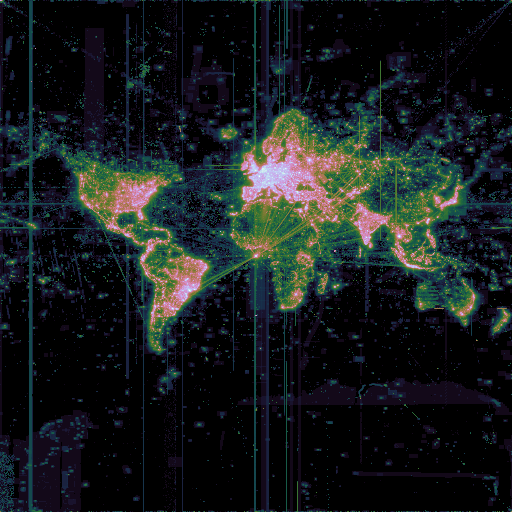

# OpenStreetMap Tile Access Images

This software generates heatmaps showing accesses of OpenStreetMap tiles.

<!-- Created with osmtileimage --zoom 9 --start 2026-10-01T12:00:00 --end 2026-10-01T12:00:00 -->
<div align="center">



</div>

## Usage

```sh
AWS_PROFILE=osm-service-logs osmtileimage
```

This will generate a 4096x4096 px image showing raster tile requests for the most recent hour that data is available for and save it as `tiles-YYYY-MM-DD-HH.png`

### Options

#### `--layer`
Default: `raster`

Define the layer to query logs for. Valid values: `raster`, `vector`


#### `--start`
Default: The most recent hour which has aggregated logs

Timestamp to start image generation at, inclusive. Truncated down to a 1 hour resolution.

Only periods that have been aggregated by ofastlylog can have images generated

#### `--end`
Default: The most recent hour which has aggregated logs

Timestamp to end image generation at, inclusive. Truncated down to a 1 hour resolution.

Only periods that have been aggregated by ofastlylog can have images generated

#### `--max`
Max value for the color scale. By default the max value is the maximum value found in the data but when comparing images from different times you want a fixed maximum.

#### `--prefix`
Default: `tiles-`

Prefix for the image name. May contain `/` for directories.


#### `--zoom`
Default: 12
osmtileimage will restrict the query to this zoom and higher and convert all tile views to views at this zoom.

The image will be 2<super>zoom</super> pixels in both directions.

### Improving image size

If sending images to other it can help to run them through oxipng. This cuts the size down to about a third of before. A good set of options is

```sh
oxipng --zc 12 -f 0,9 --fast -p -a tiles-*.png
```
